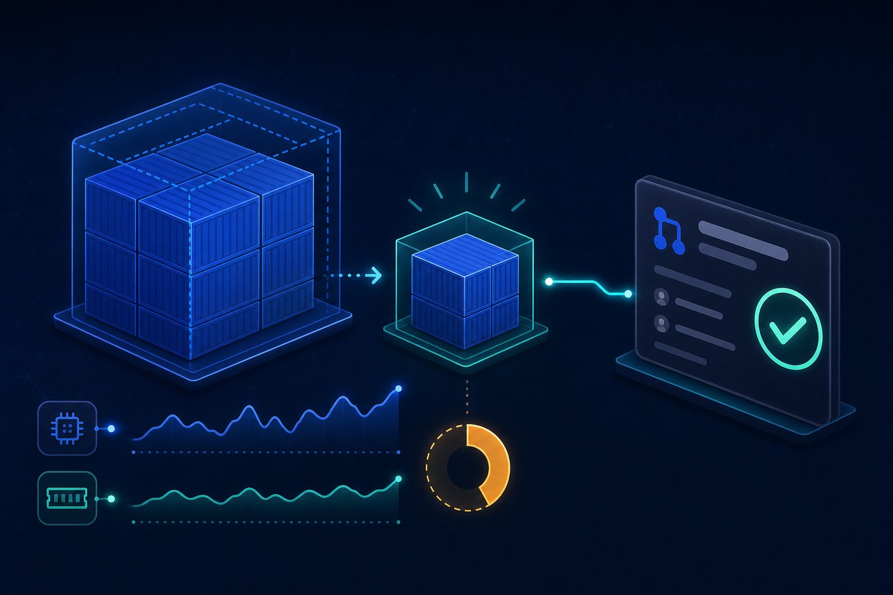
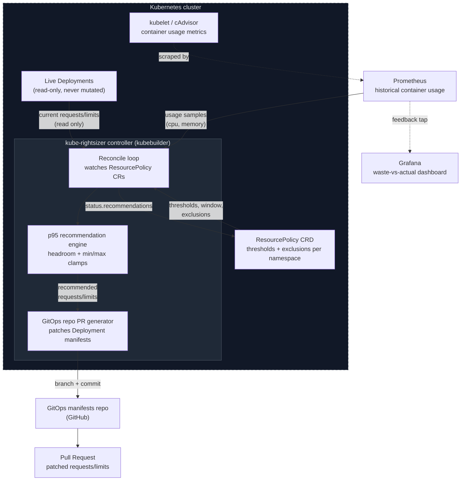

# kube-rightsizer

**Right-size Kubernetes workloads from real usage history, as a reviewable pull request, never a live mutation.**



[](https://github.com/shettysakshith-dotcom/kube-rightsizer/actions/workflows/ci.yml)
[](LICENSE)

## Why

Most teams set CPU/memory `requests` once, at deploy time, as a guess, and then never revisit them. The result is a lot of provisioned compute that is never used. Nobody right-sizes proactively because:

- **It's manual and easy to get wrong.** Turning a Grafana chart into a `kubectl edit` is toil nobody prioritizes.
- **Automatic resizing changes live workloads.** The Vertical Pod Autoscaler can update Pod resources and evict Pods to apply them, which some teams do not want in production.
- **There's no audit trail.** Even when someone does right-size manually, it rarely goes through code review.

**kube-rightsizer** takes a different approach: it never touches a live object. It watches real Prometheus usage history, computes a statistically sound (p95 + safety headroom) recommendation per container, and opens a **GitHub pull request** against your GitOps manifests repo. A human (or your existing auto-merge policy) reviews and merges it like any other change, your normal rollout, canary, and rollback machinery keeps working exactly as it does today.

## Features

- Per-container CPU and memory recommendations from Prometheus usage history (default p95 plus headroom), with independent percentile, headroom, min/max clamps and request-to-limit multiplier for each resource.
- A change threshold so stable workloads do not generate PR noise.
- Surgical YAML patching: only `resources.requests` and `resources.limits` change; comments, formatting and unrelated fields are preserved.
- Pull requests opened against a GitOps repo through go-git and the GitHub API; live objects are never mutated.
- A namespaced `ResourcePolicy` CRD with per-workload and per-container exclusions, and `status.recommendations` for every computed result.
- Helm chart, sample manifests, a kind demo script and a Grafana waste-vs-actual dashboard.

## Architecture



**Why a PR, not a Pod patch?** Every recommendation goes through the same review, CI and rollout pipeline as any other manifest change, so approval, canarying and rollback are handled by tooling you already run. The controller does not need its own approval or rollback logic, and the change history lives in git.

## How it works

1. **`ResourcePolicy` CRD** - a namespaced custom resource that configures, per namespace: the historical look-back window (`7d`, `24h`, ...), the percentile and safety headroom for CPU and memory independently, hard min/max clamps, workload/container exclusions, and the GitOps repo + branch + manifest path a PR should target.
2. **Reconcile loop** - on each tick, the controller lists the Deployments a policy selects, and for every container queries Prometheus for `rate(container_cpu_usage_seconds_total[5m])` and `container_memory_working_set_bytes` over the configured window.
3. **Recommendation engine** (`internal/recommend`) - computes the p-th percentile (default p95) of the usage samples, adds the configured headroom (default 15%), clamps to any configured floor/ceiling, and derives a limit via a configurable request→limit multiplier. Pure function of `[]float64 -> Recommendation`, independent of Kubernetes or Prometheus types, so its math is exhaustively unit tested in isolation.
4. **Change threshold** - a recommendation is only acted on if it differs from the container's current request by more than `changeThresholdPercent` (default 10%), so a stable workload doesn't generate PR noise every reconcile.
5. **GitOps PR generator** (`internal/gitops` + `internal/patch`) - clones the GitOps manifests repo, checks out a new branch, surgically patches only the `resources.requests`/`resources.limits` of the affected containers in the target Deployment's YAML (via a `yaml.Node` tree edit, so comments/formatting/unrelated fields are untouched), commits, pushes, and opens a pull request with a table summarizing the change. **No live cluster object is ever modified.**
6. **Status + feedback loop** - every computed recommendation (whether or not it crossed the PR threshold) is written to `ResourcePolicy.status.recommendations`, and the included Grafana dashboard (`dashboards/waste-vs-actual.json`) plots requested vs. p95-actual usage and an estimated waste percentage, sourced from the same Prometheus cAdvisor/kubelet container metrics.

## Quick start

### Prerequisites
- Go 1.23+
- `kind` + `kubectl` (for the local demo; no cloud account needed)
- A GitHub personal access token with `repo` scope (only needed to actually open PRs against a real GitOps repo - the demo below runs in dry-run mode without one)

### Run the tests (fully offline - no cluster, no Docker daemon, no network)

```bash
go build ./...
go test ./...
```

All recommendation math, YAML patching, and GitOps git operations are tested against in-memory fakes and local git fixtures, nothing here requires a live Prometheus, GitHub, or Kubernetes API server. An optional, more expensive suite against a real (ephemeral) `envtest` API server is available but excluded by default:

```bash
go install sigs.k8s.io/controller-runtime/tools/setup-envtest@latest
export KUBEBUILDER_ASSETS=$(setup-envtest use 1.31.0 -p path)
go test ./internal/controller/... -tags=envtest -run TestEnvtest -v
```

### Try it against a local kind cluster (dry-run, no GitHub needed)

`hack/kind-demo.sh` creates a kind cluster, installs metrics-server and the `ResourcePolicy` CRD, and applies a demo Deployment and a dry-run policy (no `gitOps` target, so recommendations appear only in `.status`). It does not install Prometheus. The controller always reads usage history from a Prometheus server, so you need one that scrapes the cluster's cAdvisor metrics (for example kube-prometheus-stack) and is reachable on `localhost:9090`:

```bash
./hack/kind-demo.sh
# in another terminal, expose your in-cluster Prometheus on localhost:9090 (service name varies by install)
kubectl -n monitoring port-forward svc/prometheus-server 9090:80
go run ./cmd/manager --prometheus-address=http://localhost:9090
kubectl get resourcepolicy -n shop default -o yaml   # watch status.recommendations populate
```

### Deploy with Helm (against a real cluster + Prometheus + GitOps repo)

```bash
kubectl create secret generic kube-rightsizer-github-token \
  --from-literal=token="$GITHUB_TOKEN" -n kube-rightsizer-system

helm install kube-rightsizer ./charts/kube-rightsizer \
  --namespace kube-rightsizer-system --create-namespace \
  --set prometheus.address=http://prometheus-server.monitoring.svc:9090

kubectl apply -f config/samples/rightsizer_v1alpha1_resourcepolicy.yaml
```

## Example `ResourcePolicy`

```yaml
apiVersion: rightsizer.slate.dev/v1alpha1
kind: ResourcePolicy
metadata:
  name: default
  namespace: shop
spec:
  window: "7d"
  minSamples: 200
  changeThresholdPercent: 10
  cpu:
    percentile: 95
    headroomPercent: 15
    limitMultiplier: "2"
    minRequest: "20m"
    maxRequest: "4000m"
  memory:
    percentile: 95
    headroomPercent: 20
    limitMultiplier: "1.5"
    minRequest: "64Mi"
    maxRequest: "8Gi"
  exclusions:
    - workload: checkout-api
      container: sidecar-proxy
  gitOps:
    repo: shop/gitops-manifests
    baseBranch: main
    manifestPath: apps/shop
    prLabels: [rightsizer, automated]
```

## Project layout

```
api/v1alpha1/          ResourcePolicy CRD types
internal/recommend/    p95 + headroom + clamp recommendation math (pure, heavily unit-tested)
internal/metrics/      Prometheus usage-history client + interface + in-memory fake
internal/patch/        Surgical YAML patching of Deployment manifests via yaml.Node
internal/gitops/       git plumbing (go-git) + GitHub PR opener, both behind interfaces
internal/controller/   The Reconcile loop tying it all together
cmd/manager/           Controller entrypoint (flags, manager wiring)
config/                CRD, RBAC, sample ResourcePolicy
charts/kube-rightsizer/ Helm chart
dashboards/            Grafana "waste vs actual" dashboard
hack/                  kind demo script + demo fixtures
```

## Testing

`go test ./...` covers the recommendation math, YAML patching, the Prometheus client (against an HTTP test server), the git operations (against local fixtures) and the reconciler (against a fake client and in-memory fakes). CI also runs `gofmt`, `go vet`, golangci-lint, `helm lint` and a Docker build. The envtest job runs in CI but is non-blocking (`continue-on-error`), because it downloads Kubernetes control-plane binaries at run time.

## Limitations and non-goals

- **Manifest discovery convention**: the controller currently expects one file per workload at `<manifestPath>/<workload>.yaml` in the GitOps repo. Searching the whole repo for a matching `kind: Deployment` would remove that constraint at the cost of an extra clone-and-scan step; left as a natural follow-up.
- **One PR per workload per reconcile** - if multiple containers in the same Deployment change, they're batched into a single commit/PR; if the same workload changes again before the previous PR merges, a new branch (named by policy generation) is opened rather than updating the existing one.
- **HPA interaction** is intentionally out of scope: this project only changes `requests`/`limits`, not replica counts, and assumes reviewers evaluate any interaction with an existing HorizontalPodAutoscaler as part of the normal PR review.

## License

MIT, see [LICENSE](LICENSE).

## Maintainer

Originally developed by Sakshith Shetty and currently maintained by Sakshith Shetty.

- GitHub: [shettysakshith-dotcom](https://github.com/shettysakshith-dotcom)
- LinkedIn: [Sakshith Shetty](https://www.linkedin.com/in/sakshith-shetty)
- Email: [shetty.sakshith@gmail.com](mailto:shetty.sakshith@gmail.com)